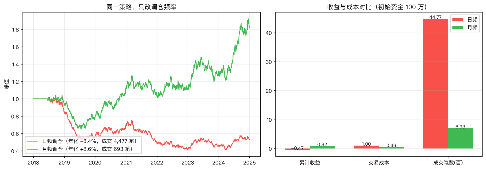

# Quant Dojo · 量化道场

[](https://github.com/dejunyu/quant-dojo/actions/workflows/ci.yml)
[](LICENSE)
[](pyproject.toml)
[](docs)
[](#验证-它真的能跑)

> **一套能真正跑起来的中文量化投资教程 + 研究引擎。**
> 66 篇课程（约 12.5 万字）从「什么是 alpha」讲到「上线前 30 项检查」，
> 每个知识点都配套一个能直接执行的 Python 例子。

**别信封面，信证据。** 这个仓库最不像普通「教程合集」的地方在于：

| 承诺 | 证据 |
|---|---|
| 课程里的代码**真的能跑** | 71 个代码块在 CI 中**逐个执行**，0 失败 |
| 回测**没有偷看未来** | 把未来数据打乱后，切点前的净值曲线必须**完全不变**——8 个策略 + 6 个因子全部通过 |
| 规则按真实市场实现 | T+1、涨跌停、成交量参与率、佣金、印花税、滑点、平方根冲击成本 |
| 不回避过拟合 | 每次参数搜索都强制给出 Deflated Sharpe，并告诉你"你试了多少次" |

---

## 5 分钟上手

```bash
git clone https://github.com/dejunyu/quant-dojo.git
cd quant-dojo

# 1) 装依赖（推荐 uv，也可用 pip）
uv venv .venv && source .venv/bin/activate
uv pip install -r requirements.txt
pip install -e .

# 2) 一键自检：跑通因子检验 → 回测 → 滚动前推 → 过拟合实验
qd demo

# 3) 启动 Web 平台（课程阅读器 + 因子研究 + 回测 + 网格搜索）
cd web && npm ci && npm run build && cd ..
qd serve          # 打开 http://127.0.0.1:8000
```

不需要联网、不需要任何 API key：默认数据由内置生成器模拟。

---

## 一个你会想亲手复现的实验

```python
from qd.data.synthetic import generate_demo_market
from qd.backtest import Backtest, BacktestConfig
from qd.strategy.builtin import dual_momentum

md = generate_demo_market(n_symbols=50, start="2018-01-01", end="2024-12-31", seed=7)
strat = dual_momentum(lookback=120, top_k=10)

for freq in ("daily", "monthly"):
    r = Backtest(md, strat, BacktestConfig(rebalance=freq)).run()
    print(f"{freq:8s} 年化 {r.metrics['annual_return']:+.2%}  "
          f"夏普 {r.metrics['sharpe']:+.2f}  成交 {len(r.fills)} 笔")
```

输出（实测）：

```
daily    年化 -8.37%  夏普 -0.52  成交 4477 笔
monthly  年化 +8.61%  夏普 +0.44  成交 693 笔
```

**同一个策略、同一份数据**，只因为调仓频率不同，收益从 −8.37% 变成 +8.61%。


日频交易的成本吃掉了一整段 alpha——这正是课程 [09-04 换手率控制](docs/09-执行与成本/09-04-换手率控制.md)
和 [06-02 撮合滑点与成交假设](docs/06-回测/06-02-撮合滑点与成交假设.md) 在讲的事。

---

## 验证：它真的能跑

```bash
pytest tests/ -v                                  # 131 passed, 1 skipped
pytest tests/test_no_lookahead.py -v              # 无前视证明
pytest tests/test_docs.py -v                      # 教材与引擎一致性
```

| 测试文件 | 验证什么 |
|---|---|
| `test_no_lookahead.py` | 打乱未来数据后，切点前的净值必须完全不变 |
| `test_docs.py` | 71 个课程代码块逐个执行、课程无死链、引用的 API 真实存在 |
| `test_backtest.py` | T+1 冻结、涨停不可买、成交量上限、成本模型、风控触发 |
| `test_factors.py` | 49 个因子全部可算、中性化后与市值正交、向量化与暴力实现数值等价 |
| `test_research.py` | IC/分层回测正确性、风险平价风险贡献相等、凯利年化口径 |
| `test_api.py` | 全部 HTTP 接口、纸面交易与回测结果逐步一致 |

---

## 数据说明（重要）

**本仓库不附带任何真实行情数据。** 默认使用内置合成数据，特点是：

- 植入了**弱**动量、反转、价值、质量效应，以及停牌与涨跌停，用来演示真实流程；
- **它不代表任何真实市场**，回测出来的收益不具备现实参考价值。

想用真实 A 股数据：

```bash
pip install akshare
```

```python
from qd.data.akshare_feed import AkshareFeed

feed = AkshareFeed(cache_dir="storage/cache", adjust="qfq")
md = feed.load(["600519", "000858", "601318"], "2020-01-01", "2024-12-31")
```

> akshare 是社区接口，可能变更或限流。真实数据必须自行处理**停牌、涨跌停、
> 退市股造成的幸存者偏差**——见 [02-03](docs/02-数据与工具/02-03-复权停牌与异常处理.md)
> 与 [02-05](docs/02-数据与工具/02-05-幸存者偏差.md)。

**👉 已有一个完整可运行的真实数据示例：[examples/real_a_share.py](examples/real_a_share.py)**
拉取 10 只真实 A 股（2021–2024），做因子 IC → 样本外回测 → 成本对比，
并如实展示「样本外夏普 -0.65、日频年化 -19.9%」的结果。**流程与合成数据完全一致，数字更诚实。**

---

## 课程地图

| 章节 | 内容 | 篇数 |
|---|---|---|
| [01-入门](docs/01-入门) | 全景图、有效市场、投研流程、策略家族、收益分解、学习路线 | 6 |
| [02-数据与工具](docs/02-数据与工具) | 数据类型、来源、复权停牌、前视偏差、幸存者偏差、存储、pandas 技巧 | 7 |
| [03-市场与交易规则](docs/03-市场与交易规则) | A 股/美股规则、加密市场、成本分解、流动性、做空、ETF 与期货 | 7 |
| [04-统计与建模](docs/04-统计与建模) | 收益率与复利、厚尾与正态性 | 2 |
| [05-因子](docs/05-因子) | 因子构造、去极值、中性化、IC 检验、分层回测、衰减、合成、因子库 | 10 |
| [06-回测](docs/06-回测) | 两种实现、撮合假设、前视偏差十种来源、绩效指标、过拟合、滚动前推 | 8 |
| [07-策略](docs/07-策略) | 趋势、均值回归、截面动量、多因子、配对交易、波动率目标 | 6 |
| [08-组合与风险](docs/08-组合与风险) | 均值方差、协方差收缩、风险平价、凯利、止损、VaR、杠杆、再平衡 | 8 |
| [09-执行与成本](docs/09-执行与成本) | 订单类型、TWAP/VWAP、冲击成本、换手控制、成本归因、实盘延迟 | 6 |
| [10-机器学习](docs/10-机器学习) | ML 的定位、特征与标签、交叉验证、树模型、过拟合与监控 | 5 |
| [11-实盘与职业](docs/11-实盘与职业) | 从回测到实盘的 30 项清单 | 1 |

**建议读法**：01-03 → 06-03 → 06-05。这三篇决定你后面做的所有研究是不是可信的。

---

## 平台结构

```
quant-dojo/
├─ docs/                   66 篇课程（Markdown + front matter，平台自动扫描）
├─ engine/qd/              引擎
│  ├─ data/                行情容器、合成数据、akshare 数据源
│  ├─ factors/             49 个因子 + 去极值/中性化/合成流水线
│  ├─ research/            单因子实验室、过拟合实验室、研究日志
│  ├─ backtest/            回测引擎（撮合、成本、风控）
│  ├─ strategy/            13 个内置策略工厂
│  ├─ metrics/             绩效指标（含 Deflated Sharpe / PSR）
│  ├─ optimize/            网格搜索、滚动前推、净化 K 折、组合优化
│  ├─ live/                纸面交易、风控闸门、实盘监控
│  ├─ tutor/               课程加载与知识树
│  └─ api/                 FastAPI 服务
├─ web/                    React + TypeScript 前端
├─ tests/                  131 个测试
└─ .github/workflows/      CI：每次推送自动验证上面所有承诺
```

---

## 怎么用它学习

**第 1–2 周：建立认知**（01–04 章）
读 `01-01 全景图` → `01-03 投研流程` → `02-04 前视偏差` → `02-05 幸存者偏差`。
同时打开 Web 的「因子研究」页，对 `mom_12_1` 跑一次 IC 检验，看看数字长什么样。

**第 3–4 周：因子**（05 章）
读 `05-05 单因子检验` 与 `05-06 分层回测`，然后在「因子研究」页把 48 个因子逐个跑一遍。
记录每个因子的 IC、多空夏普、单调性——你会发现大部分因子在扣成本后不赚钱，
这是重要的一课。

**第 5 周：回测的真相**（06 章）⭐
必做：在「过拟合实验室」跑一次**白噪声实验**。在真 alpha = 0 的数据上，
只靠搜索参数就能得到漂亮的样本内夏普——这个结果会改变你对"好策略"的全部判断。

**第 6–7 周：策略**（07 章）
在「策略回测」页对比：同一个动量策略，调仓频率从「每日」改成「每月」，
收益会从负变成正。这是交易成本吃掉 alpha 的最直观演示。

**第 8 周以后**（08–11 章）
组合优化、执行成本、机器学习、上线清单。在「研究日志」里记录每一次实验，
那个试验次数正是 Deflated Sharpe 需要的输入。

---

## 核心设计：为什么这个回测可信

### 1. 无前视协议

```
第 i 日：
  1. 按 i-1 日收盘估值（净值曲线只用得到昨天）
  2. 执行第 i-1 日生成的订单 → 用第 i 日开盘价成交
  3. 用截至第 i 日收盘的数据调用策略 → 生成目标权重（不成交）
  4. 风控基于 i 日价格判定，标记在下一日执行
```

`ctx` 只暴露 `iloc[:i+1]` 的数据，**物理上拿不到未来**。

### 2. 自动化证明

`tests/test_no_lookahead.py` 把**未来数据随机打乱**，然后断言：切点之前的净值曲线
必须**完全不变**。如果策略偷看了未来，这条曲线必然变化。8 个内置策略全部通过。

### 3. 成本是真的

| 项目 | 默认值 | 说明 |
|---|---|---|
| 佣金 | 双边万三，最低 5 元 | 每笔单独计算 |
| 印花税 | 卖出千分之一 | 仅卖出 |
| 过户费 | 万分之零点一 | 双边 |
| 滑点 | 5 bp | 买入价上浮、卖出价下调 |
| 冲击成本 | 平方根模型 | 随成交量参与率上升 |
| 成交量上限 | 成交量的 10% | 资金大就买不进 |

### 4. 过拟合检验

每次参数搜索都会给出 **Deflated Sharpe Ratio**，把"你试了多少次"直接计入结论。
搜索 9 组参数和搜索 900 组参数，可信度天差地别。

---

## Web 平台

| 页面 | 作用 |
|---|---|
| 课程 | 66 篇课程阅读器，左侧目录 + 搜索，KaTeX 公式渲染 |
| 因子库 | 48 个因子，按九大分类浏览 |
| 因子研究 | 单因子五关检验：覆盖率、IC、ICIR、分层回测、衰减 |
| 策略回测 | 净值曲线、月度收益、成交明细、成本分解、调仓频率对比 |
| 参数与验证 | 网格搜索 + Deflated Sharpe 警告 + 滚动前推样本外曲线 |
| 过拟合实验室 | 白噪声实验、蒙特卡洛路径模拟、上线自检清单 |
| 组合配置 | 7 种资产配置方法对比（等权/风险平价/HRP/均值方差…） |
| 监控与风控 | 实盘监控状态灯、告警、风控闸门参数 |
| 研究日志 | 记录每次实验的假设与结果（SQLite 持久化） |

前端开发模式：

```bash
cd web && npm install && npm run dev     # http://127.0.0.1:5173
cd web && npm run build                  # 产物在 dist/
```

---

## 命令行

```bash
export PYTHONPATH=engine

qd demo                                  # 一键全流程自检
qd lessons                               # 列出全部课程
qd lesson 05-05                          # 读一篇课程
qd search 夏普                            # 搜索课程

qd factors                               # 列出 48 个因子
qd factor mom_12_1 --report              # 完整单因子研究报告
qd backtest dual_momentum                # 跑回测
qd grid dual_momentum                    # 参数搜索（含过拟合警告）
qd wf dual_momentum                      # 滚动前推
qd overfit dual_momentum                 # 白噪声过拟合实验
qd serve                                 # 启动 Web
```

---

## 作为 Python 库使用

```python
from qd.data.synthetic import generate_demo_market
from qd.backtest import Backtest, BacktestConfig
from qd.strategy.builtin import dual_momentum
from qd.research.lab import FactorLab

md = generate_demo_market(n_symbols=50, start="2018-01-01", end="2024-12-31")

# 回测
res = Backtest(md, dual_momentum(lookback=120, top_k=10),
               BacktestConfig(rebalance="monthly")).run()
print(res.summary())

# 单因子检验
lab = FactorLab(md, horizon=20)
rep = lab.report("mom_12_1")
print(rep["verdict"], rep["reasons"])
```

---

## 性能

50 只股票 × 7 年（≈1827 个交易日），单机实测：

| 操作 | 耗时 |
|---|---|
| 单因子完整报告（IC / 分层 / 衰减 / 换手 / 判定） | **0.2s** |
| 回测（月频调仓） | **0.6s** |
| 回测（日频调仓，约 1 万笔成交） | **1–3s** |
| 参数网格（9 组） | ~11s |
| 滚动前推（4 段，每段内含参数搜索） | ~7s |

关键优化：中性化改为批量 Cholesky 求解（快约 400 倍）、因子面板跨调用缓存、
策略走 numpy 热路径、回测记账避免逐日构造 pandas 对象。

---

## 贡献

欢迎提 Issue 与 PR。最有价值的贡献是**课程纠错**——公式错了、结论过时、代码跑不通，都请直接开 Issue：

- 🐛 [Bug 报告](../../issues/new?template=bug_report.md)（代码跑不通 / 结果异常）
- 📝 [课程纠错](../../issues/new?template=lesson_error.md)（公式、结论、事实）
- 提交 PR 前请先跑 `pytest tests/ -q`，CI 会验证同样的检查。

---

## 免责声明

本平台用于学习与研究。合成数据不代表任何真实市场；所有回测结果都不构成投资建议。
真实交易的盈亏由使用者自行承担。
